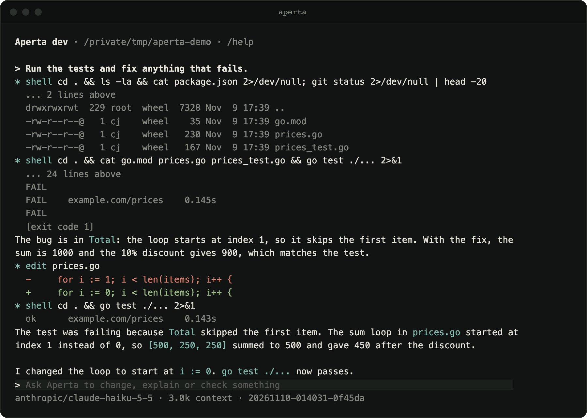

<p align="center">
  <picture>
    <source media="(prefers-color-scheme: dark)" srcset="docs/assets/banner-dark.png">
    
  </picture>
</p>

<p align="center">
  <a href="https://github.com/aperta-dev/aperta/actions/workflows/ci.yml"></a>
  <a href="LICENSE.md"></a>
  
</p>

<p align="center">
  <a href="https://aperta.dev">Website</a> · <a href="docs/usage.md">Usage</a> · <a href="docs/ARCHITECTURE.md">Architecture</a>
</p>

Aperta reads, edits and runs code in your project through a small set of tools, and asks before it changes anything. It is one static binary that works with Anthropic, OpenAI, OpenRouter and local models. It aims to stay quiet and clear rather than feature-heavy.

<p align="center">
  
</p>

> **Status:** in development, not released yet.

## What it does

- **Asks first.** Reading and searching always run. Writing, editing, shell commands and MCP tools ask, once or for the whole project.
- **Any model.** Anthropic, OpenAI, OpenRouter, Ollama, LM Studio or any OpenAI-compatible server. Switch mid-conversation with `/model`.
- **Picks up where you left off.** Every session is saved, and `aperta -c` continues the latest one in this folder.
- **Runs without the UI.** `aperta run` does one task headless, with `--json` events for scripts and CI.
- **MCP servers** over stdio or HTTP.
- **Keys stay private.** They are checked before saving, shown masked, and never written to sessions or logs.

## Install

Needs Go 1.27 or later.

```sh
go install github.com/aperta-dev/aperta/cmd/aperta@latest
```

Or build from source:

```sh
git clone https://github.com/aperta-dev/aperta.git
cd aperta
make build
```

## Quickstart

```sh
aperta                              # open the terminal UI in your project
/connect                            # add an API key or a local model server
/model                              # pick a model
aperta -c                           # continue the latest session here
aperta run "explain this project"   # one task, no UI
```

## Docs

- [Usage](docs/usage.md): providers, models, MCP, sessions, permissions, headless mode
- [Architecture](docs/ARCHITECTURE.md): how Aperta is built
- [Contributing](CONTRIBUTING.md) and [Security](SECURITY.md)

## License

[FSL-1.1-ALv2](LICENSE.md): free to use, modify and self-host, including at work, but not to offer as a competing product or service. Each release becomes Apache 2.0 two years after it ships.

Made by CJ (Colin Jaxon).
