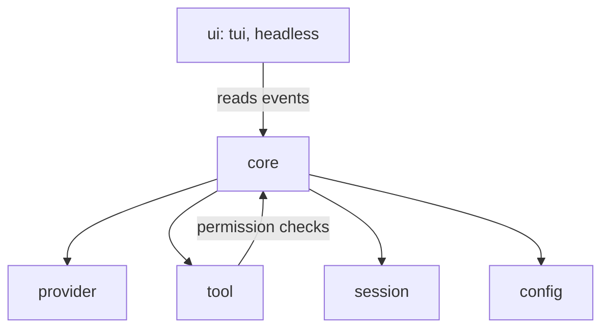

# Aperta architecture

No code yet. This records the decisions the code will follow.

## Decisions

- **Language: Go.** One static binary, `aperta`, installed with `curl aperta.dev/install | sh`.
- **No separate router process.** Providers run inside the same program.
- **First interface:** a terminal UI, plus headless mode (`aperta run --json`) from day one. Web or desktop comes later, over a local server that streams the same events.
- **Providers at launch:**
  - Anthropic Messages API
  - OpenAI Responses API
  - OpenAI-compatible: Chat Completions with a custom base URL (OpenRouter, Ollama, LM Studio)
  - Subscription logins: ChatGPT and Claude plans (see the risk below)

### Subscription login risk

Before building a subscription login, check that vendor's current terms. Anthropic has restricted the use of Claude consumer plans in third-party tools.

- API keys are the default.
- Subscription logins are optional adapters behind a feature flag.
- Build the ChatGPT plan login first. Build the Claude plan login only if the terms allow it.

## Layers

Listed bottom up. Each layer depends only on the layers it needs, and never on UI code.

1. **core**: sessions, the agent loop and permissions. It emits typed events (message delta, tool call, tool result, usage, error). Every interface just reads that stream. Core must never import UI code.
2. **provider**: one internal message and tool format, with one adapter per API. Each adapter owns streaming, tool calls, token use, retries and backoff.
3. **tool**: read, write, edit, shell, grep and glob, then web fetch and an MCP client (stdio and streamable HTTP). Every tool call goes through permissions: ask, allow once, or allow for this project.
4. **session**: an append-only JSONL file of events per session. This gives resume, branching, undo and compaction.
5. **config**: AGENTS.md instructions, markdown skills, hooks, and global plus per-project config.
6. **ui**: the terminal UI and headless JSON mode, both clients of core events.



## Layout

```
cmd/aperta/            entry point
internal/core/         agent loop, events, permissions
internal/provider/     internal format + one adapter per API
internal/tool/         built-in tools, MCP client
internal/session/      JSONL event log
internal/config/       AGENTS.md, skills, hooks, settings
internal/ui/tui/       terminal UI
internal/ui/headless/  `aperta run --json`
```

## Milestones

| Version | Scope |
| --- | --- |
| v0.1 | Agent loop, Anthropic provider, core tools (read, write, edit, shell, grep, glob), headless mode |
| v0.2 | Terminal UI, permissions, sessions and resume |
| v0.3 | OpenAI and OpenAI-compatible providers, MCP |
| v0.4 | Compaction, skills, hooks, subscription logins (where the terms allow) |
| v0.5 | aperta.dev site, installer, first public release |

## Libraries

The provider adapters (Anthropic, OpenAI Responses, Chat Completions) are small HTTP and server-sent events clients written for Aperta, not the official SDKs. They share `internal/provider/transport` for retries, backoff, idle timeouts and SSE parsing. That keeps the binary small and the retry and streaming rules in our own code.

MCP uses the official Go SDK, `github.com/modelcontextprotocol/go-sdk` v1.8.0 (Apache-2.0, with older parts MIT), which speaks protocol `2026-07-28`, the current version in November 2026. Only `internal/tool/mcp` imports it.

The terminal UI uses Bubble Tea v2, Bubbles v2 and Lip Gloss v2 (Charm, MIT), checked against their November 2026 releases. Only `internal/ui/tui` imports them.

Before adding a library, check its current docs and versions; don't pick from memory. Every dependency goes into [DEPENDENCIES.md](DEPENDENCIES.md) with its license.

## v0.1 notes

- Module path: `gitlab.com/aperta/aperta`. Go 1.27.
- Anthropic: API version `2026-10-21`, streaming only, automatic prompt caching (top-level `cache_control`). Thinking blocks go back to the API unchanged, with their signatures. No `temperature`, `top_p` or `top_k` (removed in that API version). Default model `claude-sonnet-5-5`.
- Retries: connection errors, 408, 409, 429 and 5xx (including 529), up to 4 times, honouring `retry-after` and `x-should-retry`. A stream is only retried if no text reached the user yet. A stream with no data for 5 minutes is dropped and retried.
- Tests: `cmd/aperta/e2e_test.go` builds the real binary and runs it against a fake Messages API that streams split events, a 529 retry, thinking and tool calls. `internal/tool/tool_test.go` covers glob matching, edit errors and shell limits.

## v0.2 notes

- **Terminal UI** (`internal/ui/tui`): inline, not full screen, so finished output goes into the terminal's own scrollback. Only the streaming line, the status, the permission prompt and the input box are redrawn. While a permission question is open the input box is hidden, a key hint shows, and Enter does nothing.
- **Permissions** (`core.Gate`): read, grep and glob never ask. Every other tool asks: yes once, yes for this project, or no. A project rule is a tool name (`edit`, `mcp__github__search`) or, for shell, `shell:<program>`, offered only for a plain command with no shell operators, quotes, globs or variables. Rules live in `~/.aperta/permissions.json`, keyed by the project's real path, never in the repo. Headless mode uses the same rules and denies anything else unless `--allow all`.
- **Sessions** (`internal/session`): one append-only JSONL file per session in `~/.aperta/sessions/<id>.jsonl`, mode 0600. Records: a `session` header (cwd, provider, model, version), then `message`, `usage` and `model` records. Each message has an `id` and a `parent`; resume follows the chain back from the last message, so branching and undo can add records later without rewriting the file. On resume, a half-written last line is cut off and a tool call left without a result gets an "interrupted" result.
- **System prompt**: file changes go through edit and write only, never through shell.

## v0.3 notes

- **Providers** (`internal/provider/catalog`): `--provider` picks one of anthropic (default), openai, openrouter, ollama, lmstudio, openai-compatible. Each has its key variable (`ANTHROPIC_API_KEY`, `OPENAI_API_KEY`, `OPENROUTER_API_KEY`, `APERTA_API_KEY` for openai-compatible; optional for local servers) and a default base URL that `--base-url` overrides. Default models: `claude-sonnet-5-5` and `gpt-6-sol`; the others need `--model`.
- **OpenAI Responses** (`internal/provider/openai/responses.go`): stateless (`store: false`), the whole conversation is sent each turn. Output items (reasoning with `encrypted_content`, messages with their `phase`, function calls) are kept raw in the block's `Raw` field and replayed unchanged, as the docs require. Function tools are sent with `strict: false` because our schemas have optional fields.
- **Chat Completions** (`internal/provider/openai/chat.go`): for OpenRouter, Ollama, LM Studio and any compatible server. Streams split tool calls by index, reads `reasoning_content` or `reasoning` for the thinking status (never sent back), asks for usage with `stream_options.include_usage`, and accepts a stream that ends after `finish_reason` without `[DONE]`.
- **One internal format**: each block records its `origin`. Reasoning only goes back to the API that produced it, so a session can switch provider: `aperta -c --provider openai` continues a Claude session, and the switch is saved as a `model` record so the next `-c` stays on it. Token use is normalised: `input_tokens` means uncached input for every provider.
- **MCP client** (`internal/tool/mcp`): servers live in `~/.aperta/mcp.json` (`mcpServers`, the common format), managed with `aperta mcp add | list | remove`. Stdio servers start in the project directory with their stderr in `~/.aperta/logs/mcp-<name>.log`; HTTP servers use the streamable HTTP transport with optional headers. `$VARS` in env and header values expand at start, so tokens stay out of the file. Servers connect in the background (30 s limit each); a failing server is reported and skipped. Tools are named `mcp__<server>__<tool>` (64 characters at most), follow `tools/list_changed`, and always ask permission, since a server's read-only hint can't be trusted. Text results go to the model; images and binary resources are summarised, not sent.
- **Switching models** (`/model`, `internal/ui/tui/model.go`): the picker asks `catalog.Available`, which checks keys and probes local servers' `/models` (700 ms limit) in parallel, and lists up to 3 models per provider plus "type a model id". A switch builds the new adapter through the same catalog, writes a `model` record to the session, and saves the choice per project in `~/.aperta/state.json`. New sessions start on that choice unless `--provider`, `--model` or their env vars say otherwise; a remembered model that is no longer usable falls back to the default with a warning. A switch during a turn waits for the turn to end. No history rewrite is needed: each adapter already skips reasoning it did not produce, and the Anthropic adapter cleans tool ids that other providers made.
- **Connecting** (`/connect`, `aperta connect`, `internal/provider/catalog/connect.go`, `internal/config/credentials.go`): keys live in `~/.aperta/credentials.json` (file 0600, directory 0700, written atomically). Lookup order is environment variable, then saved key, so an exported key always wins. A key is checked before it is saved with the cheapest call each API has: Anthropic `GET /v1/models`, OpenAI `GET /models`, OpenRouter `GET /key` (its model list needs no key), compatible servers `GET /models`. Errors are rewritten in plain words, any echo of the key is masked, and a rejection says what was sent ("sent 73 characters, sk-or-…479c"). Keys and URLs keep only printable ASCII, so invisible characters copied from a web page are dropped. The TUI key field is Aperta's own (`internal/ui/tui/field.go`), not a textinput: pasted chunks append, a paste repeated twice counts once, Ctrl+V does not read the clipboard a second time, and keys arriving as CSI-u events insert their text once. Keys are only ever shown masked (`sk-or-…9f2c`) and never reach session files or logs. Ollama and LM Studio are "connected" when their server answers; otherwise the start command is shown. With no flags, a new session starts on the remembered model, then the default, then any provider with a key; if there is none, the TUI opens `/connect` and headless mode exits with "run aperta connect". The `/model` picker lists providers that aren't connected in one dim line.
- **Not in v0.3**: OAuth for HTTP MCP servers (use a header token), project-level MCP config (needs a trust prompt, comes with config in v0.4), MCP prompts and resources, and the input-required tool results from the 2026-07-28 spec.
- **Tests**: `cmd/aperta/providers_test.go` runs the real binary against a fake Responses API (retry on 429, verbatim replay of reasoning and phase, usage), a fake Chat Completions server (split tool calls, no `[DONE]`), a switch from OpenAI to Anthropic mid-session, and real MCP servers over stdio (the test binary itself) and streamable HTTP with a header token.

## Open questions

What makes Aperta stand out is not decided. Candidates:

- Speed and small size
- Works with every model
- Best tool and edit accuracy
- Team or hosted features (a paid tier later)
