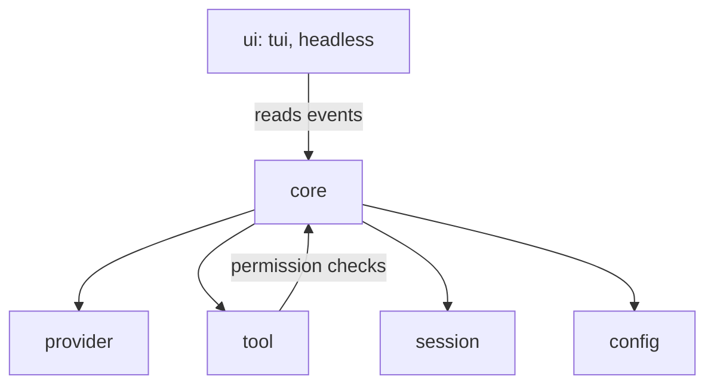

# Aperta architecture

No code yet. This records the decisions the code will follow.

## Decisions

- **Language: Go.** One static binary, `aperta`, installed with `curl aperta.dev/install | sh`.
- **No separate router process.** Providers run inside the same program.
- **First interface:** a terminal UI, plus headless mode (`aperta run --json`) from day one. Web or desktop comes later, over a local server that streams the same events.
- **Providers at launch:**
  - Anthropic Messages API
  - OpenAI Responses API
  - OpenAI-compatible: Chat Completions with a custom base URL (OpenRouter, Ollama, LM Studio)
  - Subscription logins: ChatGPT and Claude plans (see the risk below)

### Subscription login risk

Before building a subscription login, check that vendor's current terms. Anthropic has restricted the use of Claude consumer plans in third-party tools.

- API keys are the default.
- Subscription logins are optional adapters behind a feature flag.
- Build the ChatGPT plan login first. Build the Claude plan login only if the terms allow it.

## Layers

Listed bottom up. Each layer depends only on the layers it needs, and never on UI code.

1. **core**: sessions, the agent loop and permissions. It emits typed events (message delta, tool call, tool result, usage, error). Every interface just reads that stream. Core must never import UI code.
2. **provider**: one internal message and tool format, with one adapter per API. Each adapter owns streaming, tool calls, token use, retries and backoff.
3. **tool**: read, write, edit, shell, grep and glob, then web fetch and an MCP client (stdio and streamable HTTP). Every tool call goes through permissions: ask, allow once, or allow for this project.
4. **session**: an append-only JSONL file of events per session. This gives resume, branching, undo and compaction.
5. **config**: AGENTS.md instructions, markdown skills, hooks, and global plus per-project config.
6. **ui**: the terminal UI and headless JSON mode, both clients of core events.



## Layout

```
cmd/aperta/            entry point
internal/core/         agent loop, events, permissions
internal/provider/     internal format + one adapter per API
internal/tool/         built-in tools, MCP client
internal/session/      JSONL event log
internal/config/       AGENTS.md, skills, hooks, settings
internal/ui/tui/       terminal UI
internal/ui/headless/  `aperta run --json`
```

## Milestones

| Version | Scope |
| --- | --- |
| v0.1 | Agent loop, Anthropic provider, core tools (read, write, edit, shell, grep, glob), headless mode |
| v0.2 | Terminal UI, permissions, sessions and resume |
| v0.3 | OpenAI and OpenAI-compatible providers, MCP |
| v0.4 | Compaction, skills, hooks, subscription logins (where the terms allow) |
| v0.5 | aperta.dev site, installer, first public release |

## Libraries

The Anthropic adapter is a small HTTP and server-sent events client written for Aperta, not the official SDK. That keeps the binary small and the retry and streaming rules in our own code.

The terminal UI uses Bubble Tea v2, Bubbles v2 and Lip Gloss v2 (Charm, MIT), checked against their November 2026 releases. Only `internal/ui/tui` imports them.

Before picking an MCP library or provider SDKs, check their current docs and versions; don't pick from memory. Every dependency goes into [DEPENDENCIES.md](DEPENDENCIES.md) with its license.

## v0.1 notes

- Module path: `gitlab.com/aperta/aperta`. Go 1.27.
- Anthropic: API version `2026-10-21`, streaming only, automatic prompt caching (top-level `cache_control`). Thinking blocks go back to the API unchanged, with their signatures. No `temperature`, `top_p` or `top_k` (removed in that API version). Default model `claude-sonnet-5-5`.
- Retries: connection errors, 408, 409, 429 and 5xx (including 529), up to 4 times, honouring `retry-after` and `x-should-retry`. A stream is only retried if no text reached the user yet. A stream with no data for 5 minutes is dropped and retried.
- Permissions: headless mode cannot ask, so `--allow read` (the default) allows only read, grep and glob, and `--allow all` allows every tool. The interactive ask, allow once and allow for this project come in v0.2.
- Sessions: v0.1 keeps the conversation in memory. The JSONL session file comes in v0.2.
- Tests: `cmd/aperta/e2e_test.go` builds the real binary and runs it against a fake Messages API that streams split events, a 529 retry, thinking and tool calls. `internal/tool/tool_test.go` covers glob matching, edit errors and shell limits.

## Open questions

What makes Aperta stand out is not decided. Candidates:

- Speed and small size
- Works with every model
- Best tool and edit accuracy
- Team or hosted features (a paid tier later)
